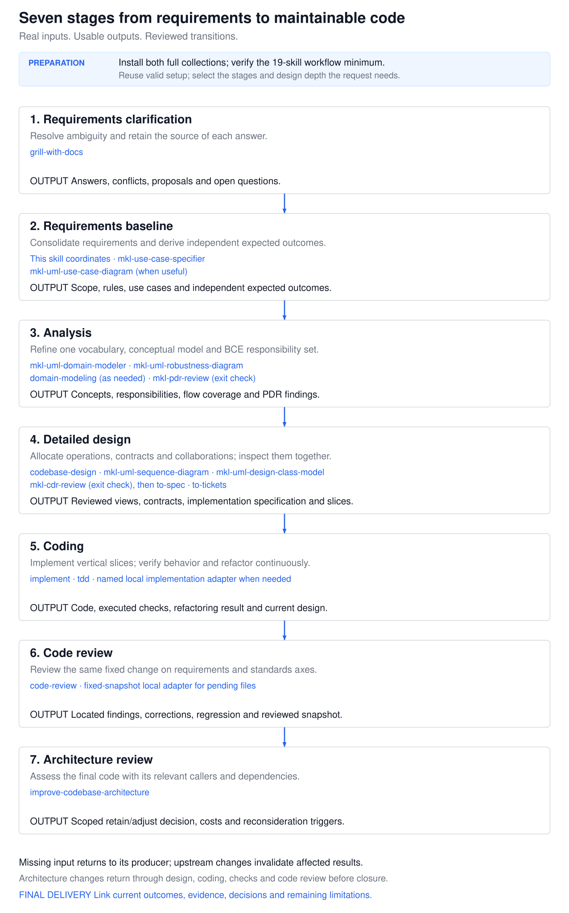
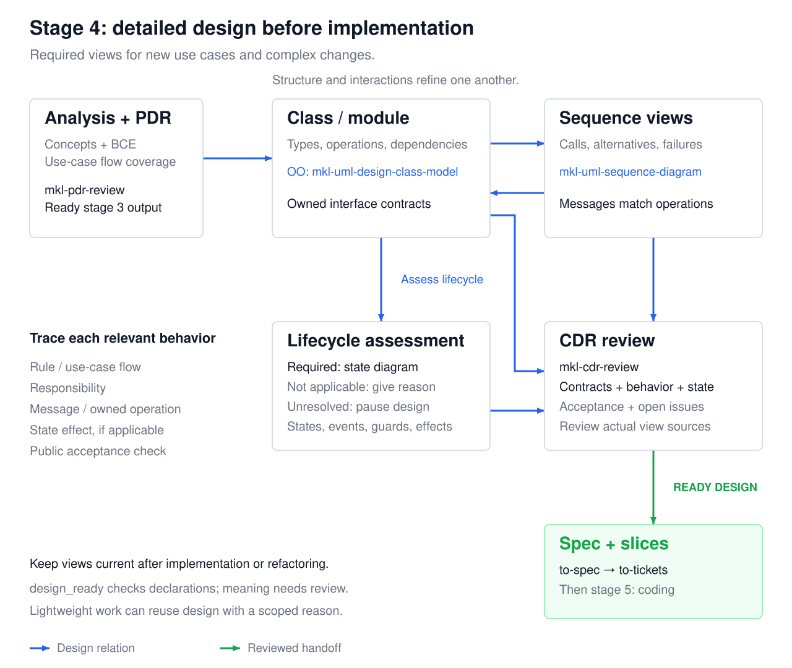
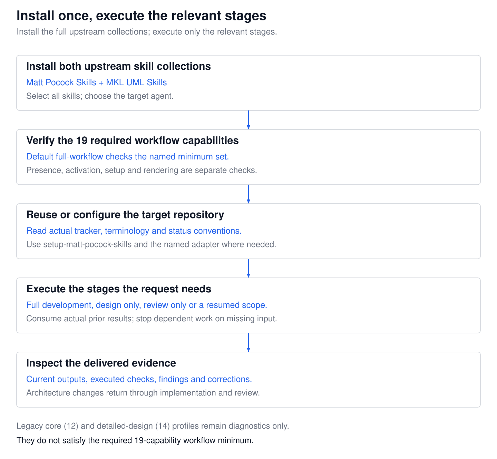
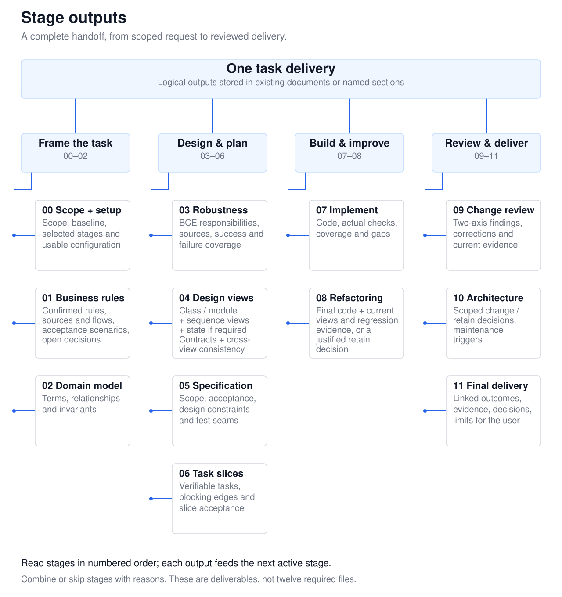

# MKL SOLID Code Development

**Build AI-assisted code that fits the business and stays easy to change.**

An agent skill that connects business rules, robustness analysis, SOLID design, implementation, verification, and review. It works with your project's language and conventions, using Matt Pocock Skills and MKL robustness analysis.

[Workflow](#workflow-at-a-glance) · [How to use](#how-to-use) · [Stage outputs](#what-each-stage-produces) · [Verification](#verification)

## Problems this skill addresses

| Common problem | How the workflow addresses it |
| --- | --- |
| Unclear business rules become silent implementation assumptions. | Clarify concrete scenarios; separate confirmed rules, proposals, and open decisions before dependent work starts. |
| A use case becomes code without clear responsibility boundaries. | Identify boundary, entity, and control responsibilities, then define modules and interface contracts. |
| Classes, interfaces, or patterns are added without a reason. | Apply SOLID to actual change scenarios, caller needs, and dependency contracts; explain the costs of each abstraction. |
| A passing test or green checklist is mistaken for business acceptance. | Connect rules to observable checks and review both requirements conformance and engineering standards. |
| Changes are difficult to review or resume in a later session. | Preserve a fixed change snapshot, actual stage outputs, current evidence, and the next consumer. |

## Workflow at a glance



Scope and prerequisites (00) come first. The five phases expand into **Understand (01–02), Design (03–04), Plan (05–06), Build (07–08), and Review & deliver (09–11)** in the output tree below.

Every active stage consumes real inputs and produces an output for the next stage. Missing input returns to its producer; a changed upstream rule invalidates affected downstream results until they are rechecked.

Robustness analysis identifies **boundary, entity, and control** responsibilities. SOLID and design patterns guide concrete design decisions. The depth follows the task: small changes can combine stages, and design-only or review-only requests end at their requested deliverable.

### Design produces actual models before code

For new use cases and complex changes, detailed design includes a **design class model** (or an explicit module/component view for non-OO code) and **sequence diagrams** for the required interactions. A **state diagram** is also required when lifecycle rules determine legal operations or outcomes. State applicability is assessed explicitly.



These views are refined together: use-case/BCE responsibilities map to interactions, owned operations/events, relevant state effects, and acceptance. Check contracts and behavior across the actual views before specification/implementation, then synchronize them after coding or refactoring. Bounded corrections may use checked reuse or a justified lightweight path. See [Design Views](references/design-views.md) for selection, outputs, routing, and readiness.

## How to use



This is the first-time path for a development repository. Reuse valid installation/setup and select stages that match the request.

### 1. Install the skill and its prerequisites

Use the standard [Skills CLI](https://skills.sh/docs/cli) from your target project. The validated CLI is `1.7.4`, requiring Node.js `>=22.20.0`, npm, Git, and access to npm/GitHub.

```bash
npx skills add kinglez/mkl-solid-code-development
npx skills add mattpocock/skills
npx skills add kinglez/mkl-uml --skill mkl-uml-robustness-diagram
```

For the Matt Pocock installation, select the **11 named skills below**. Together with the robustness skill, they form the **12-skill core baseline**. The installer lets you choose target agents; installation is project-scoped by default.

| Purpose | Required skills |
| --- | --- |
| Repository setup | `setup-matt-pocock-skills` |
| Business clarification and domain language | `grill-with-docs`, `grilling`, `domain-modeling` |
| Boundary, entity, and control analysis | `mkl-uml-robustness-diagram` |
| Module and interface design | `codebase-design` |
| Specifications and implementation slices | `to-spec`, `to-tickets` |
| Implementation and testing | `implement`, `tdd` |
| Change review | `code-review` |
| Architecture reassessment | `improve-codebase-architecture` |

The detailed-design path additionally requires these **two existing MKL skills**, for 14 definitions in total:

```bash
npx skills add kinglez/mkl-uml --skill mkl-uml-design-class-model mkl-uml-sequence-diagram
```

The class skill supports OO structure; the sequence skill supports interactions. State diagrams use the project's available UML toolchain, such as a local PlantUML renderer. No dedicated state-diagram skill is assumed. A missing renderer is reported separately from skill-definition availability.

Installing this skill does not automatically install skills from the other repositories. Required installation also does not mean every task runs every stage. Preserve existing customizations and use one installation route per agent.

For a user-wide installation, add `-g` to the relevant install command. To inspect this skill without installing it:

```bash
npx skills add kinglez/mkl-solid-code-development --list
```

For reproducible acceptance or dependency upgrades, use the [validated dependency snapshot](references/compatibility.md).

### 2. Verify availability in the current session

Confirm that the installed definitions are available to your agent. Follow its activation procedure if a new installation requires a fresh session. Installation, session availability, and repository configuration are separate checks.

#### Prerequisite checker runtime

For filesystem installations, the optional read-only checker parses actual YAML using PyYAML. From the installed `mkl-solid-code-development` directory, create an isolated environment. This is a POSIX-shell example:

```bash
python3 -m venv .venv
.venv/bin/python -m pip install -r requirements.txt
```

Use the actual directories containing `skill-name/SKILL.md`. The following are command templates; replace each `path/to/...`:

```bash
.venv/bin/python scripts/check_prerequisites.py --skills-root path/to/skills
.venv/bin/python scripts/check_prerequisites.py --skills-root path/to/project-skills --skills-root path/to/global-skills
.venv/bin/python scripts/check_prerequisites.py --skills-root path/to/skills --profile detailed-design
```

Exit `0` means the selected profile's named definitions are readable with matching YAML names: 12 for default `core`, 14 for `detailed-design`. Exit `1` means missing/invalid definitions; `2` means invalid input or parser dependency. This does not prove session activation, provenance, compatible behavior, completed setup, or a working renderer. Plugins can use the installed catalog and definition access instead.

### 3. Configure the target repository

Complete this setup before selected stages consume repository configuration. A scoped design or review that does not use a tracker does not require a new tracker setup.

Make an explicit setup request through your agent's supported invocation mechanism. For example:

> Use setup-matt-pocock-skills to configure this repository, then use mkl-solid-code-development to verify the tracker, domain-document conventions, and status mapping needed by downstream stages.

Confirm the concrete configuration choices when setup asks, and reuse valid existing configuration. The 12-skill baseline omits `triage`; the documented [local setup adapter](references/repository-setup.md) completes any status vocabulary that the upstream setup omitted. Specifications and tickets must read the actual saved configuration.

### 4. Start a scoped development task

Supply the requirements, relevant project evidence, and intended endpoint. A starting request can be:

> Use mkl-solid-code-development to implement the feature from the requirements I provide. Clarify blocking business decisions, design responsibilities and interfaces before coding, and implement verifiable slices. Deliver the stage outputs, actual verification results, and a scoped review of the changes.

New use cases default to detailed design. Before coding, inspect the class/module and sequence views, applicable state view, and their consistency review. With a structured record, `--require-design` checks the declared pre-implementation gate; final task/review readiness is checked separately. Keep the diagrams current when operations, dependencies, or lifecycle behavior change.

When a selected upstream stage is user-invoked, invoke that skill explicitly using your host's supported syntax. Typical handoffs are `grill-with-docs` for unresolved rules, `to-spec` for a confirmed design, and `to-tickets` for verifiable slices. The wrapper does not automatically invoke every installed skill. Each stage reads the preceding real output. Installation alone does not authorize commits, tracker publication, or deployment.

For uncommitted code, the [local implementation and two-axis review adapter](references/local-review.md) captures the actual tracked and untracked changes against a fixed baseline. Both review axes receive the same snapshot. The adapter is identified separately from the original upstream `implement`/`code-review` combination. Committed-history review can use the upstream route when it covers the intended delivery.

<details>
<summary>Other starting requests: design, review, or resume</summary>

**Design only**

> Use mkl-solid-code-development to design responsibilities and interfaces for the requirements I provide. End with the design, trade-offs, and proposed verification.

**Review only**

> Use mkl-solid-code-development to review the current pending changes, including new files, against the specification and repository standards. Return findings and their supporting evidence.

**Resume**

> Use mkl-solid-code-development to continue from the task record I provide. Read the referenced artifacts, check their current applicability, and continue the next unblocked stage.

</details>

### 5. Inspect the delivery

Use the stage-output tree below to check what actually exists:

- Which confirmed rules and acceptance scenarios does the code implement?
- Which preceding outputs did each active stage consume, and which decisions remain open?
- Which checks ran, what happened, and what remains unverified?
- What did the requirements and standards reviews find, and which corrections were verified?
- Which architecture decisions affect future maintenance?

The entry point for the agent is [SKILL.md](SKILL.md). Detailed execution and invocation contracts are in [Workflow Prerequisites and Skill Routing](references/optional-skills.md).

## What each stage produces



**This is a tree of logical deliverables, not a mandatory directory layout or twelve required files.** Keep outputs in existing project materials or named sections of one working document. The next active stage consumes the preceding output; the final consumer is the user.

<details>
<summary>Text version: the twelve logical stage outputs</summary>

| Stage | Output used by the next stage |
| --- | --- |
| 00 · Scope and prerequisites | Scoped request, baseline, available capabilities, usable configuration, and selected stages |
| 01 · Business clarification | Confirmed rules, flows, acceptance scenarios, sources, and open decisions |
| 02 · Domain modeling | Agreed terms, concepts, relationships, and invariants |
| 03 · Robustness analysis | Boundary/entity/control responsibilities, information sources, and success/failure coverage |
| 04 · Detailed views and contracts | Class/module and sequence sources, applicable state sources, contracts/dependencies, consistency review, and trade-offs |
| 05 · Implementation specification | Scope, acceptance, design constraints, and observable test seams |
| 06 · Task slicing | Verifiable tasks, blocking edges, and slice acceptance |
| 07 · Implementation and verification | Code changes, actual checks/results, coverage, and remaining gaps |
| 08 · Refactoring | Final code, synchronized affected views, and regression evidence, or a justified retain decision |
| 09 · Review and corrections | Two-axis findings, corrections, current snapshot, and rerun evidence |
| 10 · Architecture reassessment | Scoped change/retain decisions, maintenance costs, and reconsideration triggers |
| 11 · Final delivery | Linked outcomes, current artifacts, evidence, decisions, and limitations for the user |

</details>

Reused outputs need a current applicability check. Skipped stages need a reason; pending results remain unready. An upstream change requires affected consumers to be rechecked. See [Stage Outputs and Handoffs](references/workflow-handoffs.md) for the complete input/output contract. The [implementation brief](assets/templates/implementation-brief.md) includes a compact handoff index.

## Optional delivery-record tools

The delivery-record tools and local review capture use Python 3.10+ and its standard library; review capture also needs Git. The separate prerequisite checker requires the PyYAML runtime above.

From the skill directory, initialize a detailed-design draft. This is a command template; replace the path, ID, and objective:

```bash
python3 scripts/init_delivery.py path/to/delivery --id TASK-1 --summary "Delivery objective" --intent implement --design-profile detailed --with-brief
```

Fill in the actual rules, view sources, applicability, and consistency-review evidence. Before coding, check the design gate:

```bash
python3 scripts/validate_delivery.py path/to/delivery/delivery-record.json --require-design
```

The draft starts unready and invents no completed views or review. `--require-design` can pass before coding with `design_ready: true` while `record_ready` remains false. After implementation and final review, require both gates:

```bash
python3 scripts/validate_delivery.py path/to/delivery/delivery-record.json --require-design --require-handoffs
```

For existing/simple records, omitting `--design-profile` retains the previous format; lightweight design can be explicitly selected when justified.

Initialization refuses to overwrite existing files. Validation checks structure, references, declared evidence coverage, and readiness; it never executes recorded commands. **A ready record is not proof of correct software or SOLID compliance.** It does not judge semantic completeness or automatically detect stale content. See [Delivery Records and Tools](references/delivery-record.md) for fields, evidence requirements, and exit codes.

## Verification

With the checker runtime prepared, run this command from the skill directory:

```bash
.venv/bin/python -m unittest discover -s tests -v
```

The detailed-design update passed **101 regression tests on Python 3.12.14, 3.13.15, and 3.14.7** on macOS. These include conditional modeling prerequisites, draft initialization, independent design/final readiness gates, YAML and evidence-path failures, and actual local review capture. They are 101 distinct tests exercised on three interpreters.

The [acceptance record](tests/ACCEPTANCE.md) distinguishes executed installation, script, and independent workflow scenarios from untested environments. The [forward-testing protocol](tests/behavioral-cases.md) describes future evaluations. Neither test counts nor scenario descriptions establish correctness for every generated program.

<details>
<summary>Repository layout and additional modeling support</summary>

```text
SKILL.md                  Agent entry point
agents/openai.yaml        Skill metadata and icon references
references/               Analysis, design, setup, routing, and tool contracts
scripts/                  Prerequisite checker, delivery records, review capture
assets/diagrams/          Workflow, detailed views, usage, and deliverable tree
assets/templates/         Delivery-record, design-view, and brief templates
tests/                    Regressions, synthetic fixtures, acceptance, scenarios
requirements.txt          Pinned YAML parser for the optional checker
LICENSE, NOTICE           Project license and attribution
licenses/                 Original third-party notices
```

Beyond the conditional detailed-design pair, further MKL domain/use-case modeling aids remain optional. Required views follow the selected scope; installing skills does not enter a formal MKL gate. Teaching examples and synthetic fixtures do not supply business rules for another task.

</details>

## License

Apache-2.0; see [LICENSE](LICENSE) and [NOTICE](NOTICE). Independently installed dependencies retain their own licenses. Original notices and guidance for additional offline redistribution are in [Validated Dependencies and Distribution](references/compatibility.md).
